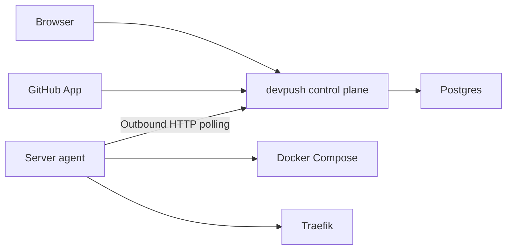

# Architecture

## Runtime shape

devpush has two runtimes:

- Control plane: TanStack Start app backed by Postgres.
- Agent: Go daemon installed on user servers.

The control plane never runs Docker directly. Agents own Docker Compose,
Traefik, local secret storage, runtime log reads, and deploy execution.

## State split

Postgres is the durable source of truth for teams, projects, servers,
environments, deployments, deploy events, deploy log chunks, GitHub metadata,
and config or secret metadata.

Deploy queues, locks, cancellation, and simple background work start in
Postgres. Valkey can be added later for cross-process coordination, scheduled
job queues, webhook smoothing, rate limits, presence, or runtime log fanout.

Important history must not exist only in ephemeral coordination storage.

## Deployment invariant

Each environment has one devpush-controlled Compose runtime. A deployment
replaces that environment runtime in place with `docker compose -p
<runtimeId> ... up -d`. Databases, Redis, queues, and volumes stay stable
because the runtime identity stays stable across deployments.

Environment IDs are stable runtime identifiers. Environment slugs are editable
labels used for branch matching and readable generated hostnames. Server
assignments, custom domains, generated environment aliases, and deployment
snapshots should key off the stable environment ID.

Only one deployment may be `running` for a runtime at a time. Postgres enforces
that with a partial unique index on running deployment runtime IDs, and the
agent claim path treats lease races as "no job available" instead of surfacing
an agent error.

devpush does not keep multiple full Compose runtimes alive for blue-green
rollback by default. Full-stack blue-green makes stateful services and scoped
volumes diverge. Future blue-green behavior should be limited to explicitly
stateless routed services.

## Snapshot invariant

Deployment rows own an immutable snapshot of the resolved deploy inputs: repo,
project, environment, server, Compose runtime config, routes, and commit
metadata. Resolved environment variables are encrypted at rest on the deployment
row. The GitHub installation token is not snapshotted; it is generated at agent
claim time and sent as a short-lived job credential.

## Log invariant

Deploy logs are sequenced by the agent and acknowledged by the control plane
after durable persistence. Runtime logs are collected from assigned Compose
runtimes by the agent and posted back to the control plane with content-hash
deduplication.
