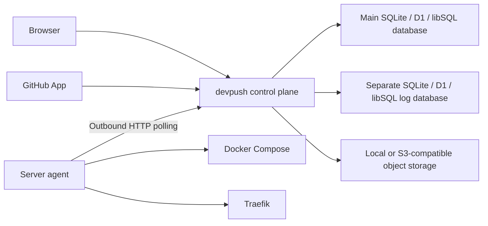

# Architecture

## Runtime shape

devpush has two runtimes:

- Control plane: TanStack Start app backed by SQLite (native files, Cloudflare D1, or remote libSQL).
- Agent: Go daemon installed on user servers.

The control plane never runs Docker directly. Agents own Docker Compose,
Traefik, local secret storage, runtime log reads, and deploy execution.

## State split

The main database is the durable source of truth for teams, projects, servers,
environments, deployments, deployment events, agent jobs, runtime observations,
backups, GitHub metadata, and config or secret metadata.

Deploy queues, locks, cancellation, request rate limits, and simple background
work use atomic SQLite statements and batches. Valkey can be added later for higher-volume
coordination, scheduled job queues, webhook smoothing, presence, or runtime log
fanout.

Important history must not exist only in ephemeral coordination storage.

Agents durably queue captured runtime logs under their state directory and
discard an upload chunk only after `200 OK` confirms all submitted lines were
accepted after persistence or deduplication. Collection checkpoints and pending
chunks survive restart; credentials are resolved at upload time and never
written into the log queue. Upload chunks are scheduled per runtime so a large
capture cannot consume another runtime's entire upload allocation.

Runtime output uses the separate log SQLite database. Identity is validated
against the main database before ingestion; every read checks main-database
project permissions and current server assignments. There are no foreign keys
between the files. Runtime inserts are bounded and idempotent, so partial
storage failures can be retried. Global maintenance removes expired runtime
output even after its server or environment stops reporting.

Agent deployment output also uses the separate log database. Small queue,
cancellation and timeout events stay in main `deployment_events` transactions
with their state changes. Reads merge the `control` and `deploy` streams after
checking project access; stored output for removed deployments is excluded.
Completion persists output first, then changes main deployment state, so either
store can fail without losing already acknowledged output. Retries use stable
agent sequence numbers and also store the tail for already terminal deployments.
Maintenance scans at most 80 deployment identities and removes at most 1,000
orphan output rows per run, retaining its scan position in log storage.

Deployment progress consumes pending output from the beginning of the queue.
Only acknowledged chunks advance its checkpoint. Completion persistence retains
the full unsent output; initial delivery and restart replay send bounded chunks
with the same sequence numbers before the final completion request.

Team member role changes and removals check the actor's current permissions,
the target's current role and remaining ownership inside one SQL mutation.
Concurrent owner demotions cannot both succeed and leave the team without an
owner. This guard works on local SQLite and D1 without callback transactions.
Ownership transfer promotes the target and demotes the acting owner in one
guarded SQL statement, using a materialized eligibility snapshot before either
role changes.

Team creation and account bootstrap use guarded atomic batches to create the
team and owner membership together. Competing bootstrap requests reuse the
first active membership and preserve a valid default team. Invitation acceptance
checks the pending token, expiration, verified email and active user/team in the
batch that adds membership and accepts the invite. Leaving a team checks its
current default-team and last-owner restrictions inside the delete statement.

Project and team deletion cancel affected work, queue runtime deprovisioning and
delayed volume purge, remove hostnames and mark resources deleted in one guarded
batch. Cleanup targets come from current environments and deployment history,
including inherited server assignments. Each agent job contains at most 200
distinct runtimes; larger target sets create additional jobs without dropping
targets. Volume purge becomes available seven days after deletion. Deletion
rechecks current management permission, and team deletion also protects active
users' default teams.

Account deletion checks ownership inside the same batch that queues user cleanup,
removes credentials and marks the account deleted. Other owners must be active
users; an account awaiting cleanup cannot satisfy the last-owner requirement.
Queued user cleanup atomically deletes the recorded sole-owned teams' resources,
clears affected default-team references, removes invitations and memberships,
and queues runtime cleanup. A failed batch leaves these effects uncommitted.

Pending OAuth identity replacement deletes the previous record and inserts the
new encrypted identity in one batch, preserving the old identity if insertion
fails.

Deployment failure and timeout handling writes its control event and terminal
status in the same guarded batch. Event sequences are calculated inside that
batch, and competing requests cannot add a second failure event. Timeout
mutations recheck the start-time cutoff and process at most 80 deployments per
batch.

Deployment and cleanup claims select the next eligible queued record inside a
single guarded update. Deployment claims skip runtimes with a running deployment,
so unrelated runtimes can execute concurrently. Backup claims update the job and
its backup run in one atomic batch, validating the candidate payload again. A
request that loses the claim reads the next candidate immediately. Successful
deployment completion moves the matching environment and branch aliases before
its terminal status update in the same batch; retries and cancellations cannot
move those aliases again.

Deployment enqueueing commits the queued record, cancellation of superseded
deployments, control events and generated aliases in one atomic batch. Duplicate
GitHub deliveries skip every effect, and an alias collision rolls back the queue
and cancellations. Generated aliases cannot take a hostname owned by a custom
domain.

Project domain and route replacements also use atomic batches. Domain changes
preserve verification when the target environment stays the same and reset it
when the target changes. Another project's hostname and generated aliases remain
reserved. Project names use the database's unique constraint to settle racing
renames.

Project creation stores the project, production environment and generated alias
in one batch. Environment replacement checks the environment and alias snapshot
used to reconcile IDs before applying its writes. A competing update causes the
service to reload and retry up to twice. Existing environment runtime IDs survive
the replacement; removed environments lose their aliases, custom domains and
scoped routes in the same batch.

Server deletion rechecks current team management permission inside its batch.
Backup jobs are canceled, monitoring samples are removed and availability windows
are closed with the status change. The caller's choice to finish or cancel ongoing
deployments is preserved, including retention of credentials for work allowed to
finish. A failed status update rolls back the preceding changes.

Backup completion commits artifact records and run/job terminal statuses in one
guarded batch. Cleanup completion deletes only the claimed artifacts and records
cleanup completion in that batch. Terminal replays cannot insert more artifacts
or clear a newer cleanup request. Stale job failure rechecks the current claim
time before changing related backup runs.

Backup enqueueing creates its run and agent job together after checking the
current environment, server and backup policy. Retention cleanup claims current
eligible runs and derives object keys from those runs inside the same batch,
preventing competing requests from queueing duplicate cleanup.

Runtime reconciliation upserts observations in groups of eight and decides orphan
cleanup from current assignments, deployments and pending cleanup jobs inside
one atomic batch. A heartbeat without service state preserves the last reported
state. Cleanup and retained-volume purge each queue at most 200 runtimes per job.

Host metrics are persisted in a single atomically replaced agent history file
before upload. The file retains a rolling 24 hours (3,600-sample safety cap)
and a checkpoint per control-plane URL plus enrolled server ID. Ordered batches
advance only after `metricsAcceptedThrough` identifies their final sample.
The hub inserts each batch atomically with JSON extraction to stay below D1's
parameter limit. A server-scoped SHA-256 of random sample ID uses the existing
metric primary key for deduplication; no sequence counter or new schema is
needed. Original collection times drive charts; hub receipt times drive liveness.
A separate resync marker is consumed by the heartbeat loop, avoiding concurrent
CLI edits of history. Its random token preserves requests arriving during upload.
Acknowledged history remains available for explicit replay after hub data loss.

Monitoring maintenance prunes raw heartbeat and metric samples after
`DEVPUSH_MONITORING_RETENTION_DAYS` (seven by default). Writes are bounded to
1,000 rows per transaction and at most ten batches per table per run.

## Authorization invariant

Installation administration and team administration are separate boundaries.
`DEVPUSH_ADMIN_EMAIL` selects the installation administrator; when it is unset,
the earliest-created user is the deterministic fallback. Admin routes and
services enforce that policy on the server. A team owner or team admin may
manage that team's servers; ordinary team members have read access but cannot
create, mutate, enroll, disable, or delete servers.

Team members may manage ordinary project settings, deployments, and pre-deploy
commands that run inside a Compose service. Only team owners and admins may
change deploy or rollback commands because those commands execute directly on
an agent host with Docker access.

User uploads use a small object-store boundary. The default adapter writes to
the local persistent uploads directory; configuring the complete
`DEVPUSH_STORAGE_*` set switches avatars and published agent binaries to an
S3-compatible bucket such as R2. Application URLs remain stable because avatar
objects are served through the control plane rather than exposed as public
bucket URLs.

Project environment variables and other application secrets are encrypted with
AES-GCM before persistence. The greenfield schema does not include plaintext
storage for project environment variables.

Public deployments fail closed when authentication and encryption secrets are
missing, weak, or reused. Auth and agent-registration abuse limits are atomic
database counters so they remain correct across Worker isolates and
self-hosted replicas. OAuth account-linking handoff state is encrypted,
expiring database state rather than process memory.

## Deployment invariant

Each environment has one stable devpush runtime identity. Managed Compose
deployments reconcile that runtime in place with `docker compose -p
<runtimeId> ... up -d`. Databases, Redis, queues, and volumes stay stable
because the runtime identity stays stable across deployments.

The agent renders a deployment-only Compose override after resolving the exact
repository revision. It removes published host ports and host networking,
leaving services private to the environment runtime network, and attaches only
routed services to the shared proxy network. Traefik owns public HTTP/HTTPS
ports 80/443.

Compose file paths are repository-relative. The control plane rejects absolute
and parent-traversal paths, and the agent resolves symlinks and checks the final
file remains inside the cloned repository before invoking Docker Compose.

Traefik reaches Docker through a pinned socket-proxy container on a dedicated
internal network. Application runtimes join the public ingress network only and
cannot reach the Docker API proxy.

Environment IDs are stable runtime identifiers. Environment slugs are editable
labels used for branch matching and readable generated hostnames. The
project owns the default server assignment; an environment may own a nullable
server override. The effective server is resolved from the override and then
the project default. Custom domains and generated aliases are separate
relational records keyed by the stable environment ID. Mutable project settings
are resolved once into the deployment row before an agent can claim the job.
Deployments reach their project through that immutable environment relationship
instead of duplicating a second project foreign key.

Only one deployment may be `running` for a runtime at a time. SQLite enforces
that with a partial unique index on running deployment runtime IDs, and the
agent claim path treats lease races as "no job available" instead of surfacing
an agent error.

Managed Compose does not promise zero downtime or keep multiple full Compose
runtimes alive. Projects that need an application-specific service update can
provide a deployment command override. The agent still checks out the exact
commit, resolves Compose, writes the environment file, generates the
managed-ingress override, prepares images, reports logs and status, and performs
container and public readiness checks. The override replaces only the standard
`docker compose up` operation.

Custom commands receive the resolved deployment variables plus
`DEVPUSH_COMPOSE_PATH`, `DEVPUSH_COMPOSE_OVERRIDE`,
`DEVPUSH_COMPOSE_PROJECT_NAME`, `DEVPUSH_ENV_FILE`, and `DEVPUSH_ACTION`. A
Compose-based command must include both the repository file and generated
override so managed ingress remains authoritative. An optional rollback command
is used for rollback jobs; otherwise the deployment command runs against the
snapshotted rollback commit with `DEVPUSH_ACTION=rollback`. Commands are
explicitly trusted host configuration: Docker access is root-equivalent, so
repository content cannot enable this mode by itself.

## Deployment record invariant

Each deployment row is the immutable record of what was deployed. Stable,
queryable identity and target data stays in columns: environment, server,
repository, Git ref, runtime, lifecycle state, and commit metadata. The project
is reached through the deployment's environment relationship.
Runtime-specific project settings are one type-discriminated `runtime_config`
JSON object. Compose currently provides the only runtime type; future
Dockerfile or Swarm drivers add union members instead of project columns. When
a deployment is queued, its immutable `config` nests the resolved runtime
object alongside expanded routes. Resolved environment variables are encrypted
in `env_vars` on the same row. GitHub installation identity remains mutable project integration state;
queued deployments do not freeze credential identifiers.
Installation records retain GitHub's stable target account ID alongside the
human-readable login. Lifecycle and rename webhooks refresh that metadata. If
token creation reports a missing cached installation, the control plane asks
GitHub for the repository's current installation, updates the project cache,
and retries once.

Parsed Compose service, volume, warning, and route metadata is project state.
It is refreshed while creating or updating a project and read from the main database
when rendering settings and backup screens. Page rendering must not wait for a
GitHub API request.

## Request rendering invariant

Route loaders perform authorization and bounded reads only. Normal GET renders
do not bootstrap accounts, repair data, call third-party APIs, download object
contents to test existence, or mutate stale records. Parent and child routes
share section-specific React Query entries so one navigation does not reload
the same team or project context multiple times. Authenticated application
routes use selective client rendering: the server sends the route-accurate
pending layout immediately, then the client runs authorization and data loaders.
Known route labels, separators, resource identities, and IDs remain visible in
pending layouts; skeletons represent only data that is genuinely unresolved.
Known controls retain their labels, icons and dimensions while disabled during
loading. Pending forms use the same field primitives and spacing as their loaded
forms; known IDs keep their copy controls. Permission-specific editing controls
are omitted for confirmed read-only members. While permissions are unresolved,
editing placeholders stay disabled. Skeleton animations respect reduced motion.
Collection placeholders represent populated rows, never empty-state cards or
claims that a collection is empty. Confirmed empty cached data renders its real
empty state immediately, including while other section data is loading.
Standalone row and detail metadata icons use 16px with flex shrinking disabled.
Commit glyphs use 20px to compensate for their short drawing; pending views use
the same dimensions. Compact badges and indicators use 12–14px, while dialog
illustrations can be larger. Buttons, menus and input groups own their icon size
and shrink behavior; feature icons inherit those defaults unless a deliberate
variant requires an override. These rules apply to icons, not chart geometry.

Pending components reuse cached server details, project sections, team settings,
and account/admin loader results instead of masking known data. Server loading
uses known enrollment status and monitoring summaries to show install guidance
immediately. Shell summaries intentionally omit monitoring; their null readings
are unresolved, not a confirmed empty state. Only resolved server details can
show the metrics empty state. Unresolved metrics retain the four chart
cards and known readings, with a centered loading message inside each chart area.
Server danger actions remain visible but disabled while data or permissions resolve;
confirmed read-only members do not see the danger section.
Static labels and disabled controls remain visible. Unknown backup lists reserve
policy rows and run columns with disabled controls.
Conditional backup-policy forms and log content use a loading message rather
than speculative sections, fields or log lines. Collection placeholders use the same card, row or table
structure as the loaded view. Incoming cached data replaces placeholders without
waiting for unrelated requests. Local repository filtering
does not introduce a loading delay; repository requests track which installation
has resolved, and background refresh errors preserve existing form state.

React Query owns the 30-second freshness window. Router loaders always consult
`fetchQuery` rather than maintaining a second freshness window; fresh data is
reused and concurrent fetches deduplicate. Shared project data is refreshed when
expired before merging it with a section. Mutations cancel older in-flight
resource reads and invalidate affected team/project entries, including inactive
entries; mutation responses then seed the saved section and shared project data.
Account and membership changes invalidate cross-team snapshots as needed.
Team metadata edits patch embedded team records in cached navigation directly,
preserving snapshot timestamps and unrelated data. Slug changes still invalidate
old route keys and navigate to the new URL. Deployment lists have no timers or
router invalidation: team-overview and project section queries poll at two seconds
while a deployment is active. Project overview uses a 15-second interval otherwise
for runtime updates. Background refresh failures retain the visible data and show
a dismissible warning that clears on recovery or leaving the page.

Authenticated team routes, account/admin settings and invitations use `ssr: false`;
server functions remain responsible for authorization. Public login keeps SSR.
Client transitions default to a 150ms pending delay and 200ms minimum display.
Runtime logs poll every two seconds while the page is visible, independently of
deployment activity. Deployment status polling stops at completion; completed
logs use a distinct query key to fetch final output and isolate late running
responses. Query polling pauses in hidden tabs by default.

By default, Node opens two distinct SQLite files with WAL, foreign keys, a busy timeout, and
full synchronization. Workers default to two D1 bindings. The main database owns
permissions and orchestration; the log database stores bulk deployment and
runtime output. Cross-store operations are not a single transaction: log chunks
are persisted and deduplicated before acknowledging receipt or terminal status.
Node and Workers select libSQL when both remote database URLs are configured.
These URLs override local paths or D1 bindings; partial remote settings fail.
Worker database adapters initialize on first use rather than module evaluation,
so Cloudflare upload validation can run before resource bindings are available.
Workers create a web client per statement or atomic batch and close it after
completion, avoiding I/O resources shared across requests. Client factories
also support database work during streaming responses and scheduled handlers.
Each store has its own URL and optional authentication token. This adapter uses
atomic libSQL write batches and positional result mapping through Drizzle's
SQLite proxy, preserving duplicate column names in joins. It does not use local
replicas or callback transactions. Remote migrations use Drizzle's libSQL
migrator; backups belong to the database provider rather than the local file
backup service.
Application mutations use prebuilt atomic SQL batches on all backends. D1 does
not support application callback transactions. Deployments run on agents and
never hold a database write transaction for the duration of the build.

The agent job payload is assembled from that one deployment row. It does not
copy current project, environment, or server settings into another operational
record. GitHub installation tokens are generated at claim time and sent as
short-lived job credentials.

GitHub push delivery IDs are persisted with deployments and uniquely scoped to
an environment. A retried webhook therefore resolves to the existing work
instead of canceling or duplicating a deployment.

Long-running agent jobs have type-specific deadlines. The agent persists every
completion without its credential to a private local outbox before sending it
and does not claim a new job until pending completions are acknowledged. It
attaches the current credential only during delivery. The control plane fails
jobs that exceed their deadline so a lost agent cannot hold an environment
indefinitely.

Maintenance shares a file lock with job claiming, execution, and completion
delivery. A drain marker prevents later claims while heartbeats continue. Updates
replace executables only after that boundary. Empty-host control-plane switches
disable the source through an atomic conditional write, isolate destination state,
and select all identity fields through one config rename. Rollback tickets bind
the source ID and disabled-row timestamp so intervening operator changes cannot
be silently overwritten. This is not migration of active deployment ownership.

S3-compatible backup destinations belong to workspaces. Policies store a
workspace-scoped destination reference and prefix; members receive only safe
metadata, while owners/admins manage connection credentials. Queued backup runs
snapshot their original destination and policy ID. Restore and retention use
that snapshot’s location with the referenced connection’s current credentials;
policy edits cannot redirect old files to a different bucket. Storage location
fields are immutable; moving future backups means selecting another connection.

Completed archives survive remote upload failures. Such runs remain failed with
`manifest.localRecoveryAvailable = true`, publish only their local artifacts and
participate in local retention. Restore accepts their retained local artifacts;
incomplete archive failures do not publish recovery files. Run and policy alerts
refresh through workspace notifications and adaptive polling. SQLite triggers
validate workspace storage references and block removing referenced connections,
including concurrent policy and run writes.

Remote backup credentials are encrypted before persistence. Queued job payloads
contain ciphertext; the control plane decrypts it only after an authenticated,
compatible agent claims the job. Backup schedule keys and a partial unique
index guarantee at most one active backup per environment and one enqueue per
policy and UTC schedule minute.

## Log invariant

Deploy logs are sequenced by the agent and acknowledged by the control plane
after durable persistence. Runtime logs are collected from assigned Compose
runtimes by the agent and posted back to the control plane with content-hash
deduplication.

## Workspace notifications

On Cloudflare, each workspace has a SQLite Durable Object with hibernating
WebSockets. The HTTP boundary authenticates the session, checks active workspace
membership and validates the socket Origin. Committed deployment enqueue and
agent mutations publish small resource-change hints through RPC. Preparation
failures before delivery and job timeouts also publish terminal changes; timeout
checks with no changed rows do not broadcast. Before each
broadcast, the publisher checks current active sessions and memberships; revoked
connections are closed. Data and logs remain in the database and are refetched
through the existing authorized queries. Notification failure cannot roll back
an acknowledged mutation.

The browser maintains one connection for the current workspace, batches hints,
reconnects with backoff and refreshes snapshots on reconnect. Hidden pages close
the connection and pause interval refetches. Browser pings use the Durable Object
auto-response to preserve hibernation. Authentication is renewed every five
minutes. Connected views retain a one-minute recovery poll. When WebSockets are
unavailable, deployment lists poll every 15 seconds when idle and every two
seconds when active; server views poll every five seconds. Node uses Nitro’s WebSocket upgrade handler and a process-local workspace
broadcaster behind the same notification interface. Normal `pnpm dev` exercises
the same browser WebSocket flow. A single Node process is supported; multiple
processes require shared pub/sub for immediate cross-process delivery. Recovery
polling still repairs missed hints.

Restore status is read from project-scoped `restore` agent jobs. The client receives
IDs, status, error and timestamps only; abandoned jobs display as failed. Restore
claims/completions use workspace invalidation, with active-job HTTP polling as a
fallback. Retention selects generations independently per storage tier, counting
only runs with remaining artifacts in that tier. A local archive from a failed
upload never displaces a successful remote copy. Database dump stdout is gzip
compressed before artifact checksumming/upload, and decompressed during restore.
