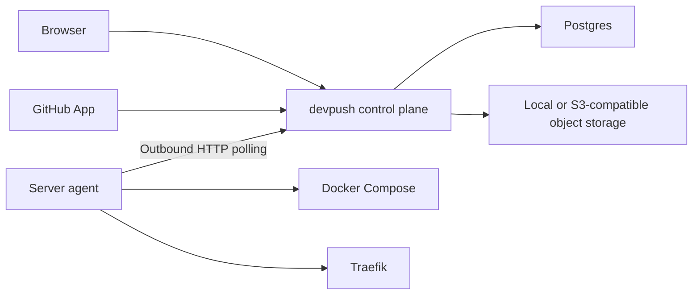

# Architecture

## Runtime shape

devpush has two runtimes:

- Control plane: TanStack Start app backed by Postgres.
- Agent: Go daemon installed on user servers.

The control plane never runs Docker directly. Agents own Docker Compose,
Traefik, local secret storage, runtime log reads, and deploy execution.

## State split

Postgres is the durable source of truth for teams, projects, servers,
environments, deployments, deployment logs, agent jobs, runtime observations,
backups, GitHub metadata, and config or secret metadata.

Deploy queues, locks, cancellation, and simple background work start in
Postgres. Valkey can be added later for cross-process coordination, scheduled
job queues, webhook smoothing, rate limits, presence, or runtime log fanout.

Important history must not exist only in ephemeral coordination storage.

## Authorization invariant

Installation administration and team administration are separate boundaries.
`DEVPUSH_ADMIN_EMAIL` selects the installation administrator; when it is unset,
the earliest-created user is the deterministic fallback. Admin routes and
services enforce that policy on the server. A team owner or team admin may
manage that team's servers; ordinary team members have read access but cannot
create, mutate, enroll, disable, or delete servers.

User uploads use a small object-store boundary. The default adapter writes to
the local persistent uploads directory; configuring the complete
`DEVPUSH_STORAGE_*` set switches avatars and published agent binaries to an
S3-compatible bucket such as R2. Application URLs remain stable because avatar
objects are served through the control plane rather than exposed as public
bucket URLs.

## Deployment invariant

Each environment has one stable devpush runtime identity. Managed Compose
deployments reconcile that runtime in place with `docker compose -p
<runtimeId> ... up -d`. Databases, Redis, queues, and volumes stay stable
because the runtime identity stays stable across deployments.

The agent renders a deployment-only Compose override after resolving the exact
repository revision. It removes published host ports and host networking,
leaving services private to the environment runtime network, and attaches only
routed services to the shared proxy network. Traefik owns public HTTP/HTTPS
ports 80/443.

Environment IDs are stable runtime identifiers. Environment slugs are editable
labels used for branch matching and readable generated hostnames. The
project owns the default server assignment; an environment may own a nullable
server override. The effective server is resolved from the override and then
the project default. Custom domains and generated aliases are separate
relational records keyed by the stable environment ID. Mutable project settings
are resolved once into the deployment row before an agent can claim the job.
Deployments reach their project through that immutable environment relationship
instead of duplicating a second project foreign key.

Only one deployment may be `running` for a runtime at a time. Postgres enforces
that with a partial unique index on running deployment runtime IDs, and the
agent claim path treats lease races as "no job available" instead of surfacing
an agent error.

Managed Compose does not promise zero downtime or keep multiple full Compose
runtimes alive. Projects that need an application-specific service update can
provide a deployment command override. The agent still checks out the exact
commit, resolves Compose, writes the environment file, generates the
managed-ingress override, prepares images, reports logs and status, and performs
container and public readiness checks. The override replaces only the standard
`docker compose up` operation.

Custom commands receive the resolved deployment variables plus
`DEVPUSH_COMPOSE_PATH`, `DEVPUSH_COMPOSE_OVERRIDE`,
`DEVPUSH_COMPOSE_PROJECT_NAME`, `DEVPUSH_ENV_FILE`, and `DEVPUSH_ACTION`. A
Compose-based command must include both the repository file and generated
override so managed ingress remains authoritative. An optional rollback command
is used for rollback jobs; otherwise the deployment command runs against the
snapshotted rollback commit with `DEVPUSH_ACTION=rollback`. Commands are
explicitly trusted host configuration: Docker access is root-equivalent, so
repository content cannot enable this mode by itself.

## Deployment record invariant

Each deployment row is the immutable record of what was deployed. Stable,
queryable identity and target data stays in columns: environment, server,
repository, Git ref, runtime, lifecycle state, and commit metadata. The project
is reached through the deployment's environment relationship.
Runtime-specific project settings are one type-discriminated `runtime_config`
JSON object. Compose currently provides the only runtime type; future
Dockerfile or Swarm drivers add union members instead of project columns. When
a deployment is queued, its immutable `config` nests the resolved runtime
object alongside expanded routes. Resolved environment variables are encrypted
in `env_vars` on the same row. GitHub installation identity remains mutable project integration state;
queued deployments do not freeze credential identifiers.
Installation records retain GitHub's stable target account ID alongside the
human-readable login. Lifecycle and rename webhooks refresh that metadata. If
token creation reports a missing cached installation, the control plane asks
GitHub for the repository's current installation, updates the project cache,
and retries once.

The agent job payload is assembled from that one deployment row. It does not
copy current project, environment, or server settings into another operational
record. GitHub installation tokens are generated at claim time and sent as
short-lived job credentials.

GitHub push delivery IDs are persisted with deployments and uniquely scoped to
an environment. A retried webhook therefore resolves to the existing work
instead of canceling or duplicating a deployment.

Long-running agent jobs have type-specific deadlines. The agent persists every
completion without its credential to a private local outbox before sending it
and does not claim a new job until pending completions are acknowledged. It
attaches the current credential only during delivery. The control plane fails
jobs that exceed their deadline so a lost agent cannot hold an environment
indefinitely.

Remote backup credentials are encrypted before persistence. Queued job payloads
contain ciphertext; the control plane decrypts it only after an authenticated,
compatible agent claims the job. Backup schedule keys and a partial unique
index guarantee at most one active backup per environment and one enqueue per
UTC schedule minute.

## Log invariant

Deploy logs are sequenced by the agent and acknowledged by the control plane
after durable persistence. Runtime logs are collected from assigned Compose
runtimes by the agent and posted back to the control plane with content-hash
deduplication.
