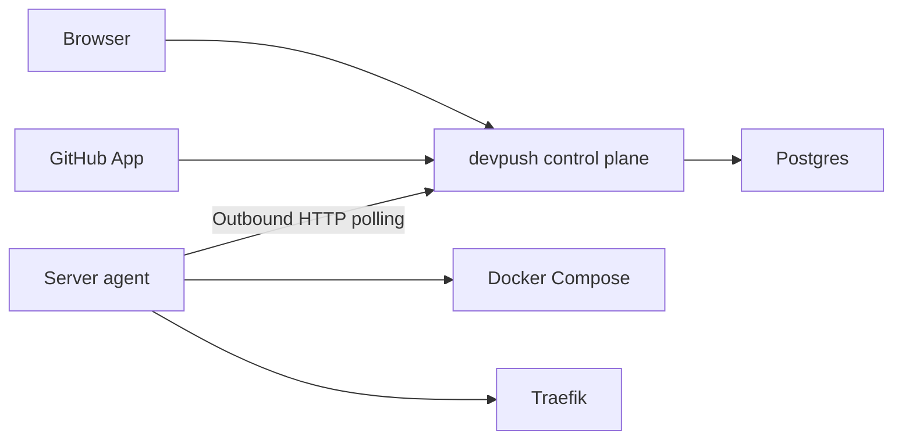

# Architecture

## Runtime shape

devpush has two runtimes:

- Control plane: TanStack Start app backed by Postgres.
- Agent: Go daemon installed on user servers.

The control plane never runs Docker directly. Agents own Docker Compose,
Traefik, local secret storage, runtime log reads, and deploy execution.

## State split

Postgres is the durable source of truth for teams, projects, servers,
environments, deployments, deployment logs, agent jobs, runtime observations,
backups, GitHub metadata, and config or secret metadata.

Deploy queues, locks, cancellation, and simple background work start in
Postgres. Valkey can be added later for cross-process coordination, scheduled
job queues, webhook smoothing, rate limits, presence, or runtime log fanout.

Important history must not exist only in ephemeral coordination storage.

## Deployment invariant

Each environment has one devpush-controlled Compose runtime. A deployment
replaces that environment runtime in place with `docker compose -p
<runtimeId> ... up -d`. Databases, Redis, queues, and volumes stay stable
because the runtime identity stays stable across deployments.

Environment IDs are stable runtime identifiers. Environment slugs are editable
labels used for branch matching and readable generated hostnames. The
project owns the default server assignment; an environment may own a nullable
server override. The effective server is resolved from the override and then
the project default. Custom domains and generated aliases are separate
relational records keyed by the stable environment ID. Mutable project settings
are resolved once into the deployment row before an agent can claim the job.
Deployments reach their project through that immutable environment relationship
instead of duplicating a second project foreign key.

Only one deployment may be `running` for a runtime at a time. Postgres enforces
that with a partial unique index on running deployment runtime IDs, and the
agent claim path treats lease races as "no job available" instead of surfacing
an agent error.

devpush does not keep multiple full Compose runtimes alive for blue-green
rollback by default. Full-stack blue-green makes stateful services and scoped
volumes diverge. Future blue-green behavior should be limited to explicitly
stateless routed services.

## Deployment record invariant

Each deployment row is the immutable record of what was deployed. Stable,
queryable identity and target data stays in columns: environment, server,
repository, Git ref, runtime, lifecycle state, and commit metadata. The project
is reached through the deployment's environment relationship. The
`config` JSON contains only resolved deployment instructions that do not merit
their own columns: Compose path, release and readiness settings, and expanded
routes. Resolved environment variables are encrypted in `env_vars` on the same
row. GitHub installation identity remains mutable project integration state;
queued deployments do not freeze credential identifiers.

The agent job payload is assembled from that one deployment row. It does not
copy current project, environment, or server settings into another operational
record. GitHub installation tokens are generated at claim time and sent as
short-lived job credentials.

## Log invariant

Deploy logs are sequenced by the agent and acknowledged by the control plane
after durable persistence. Runtime logs are collected from assigned Compose
runtimes by the agent and posted back to the control plane with content-hash
deduplication.
